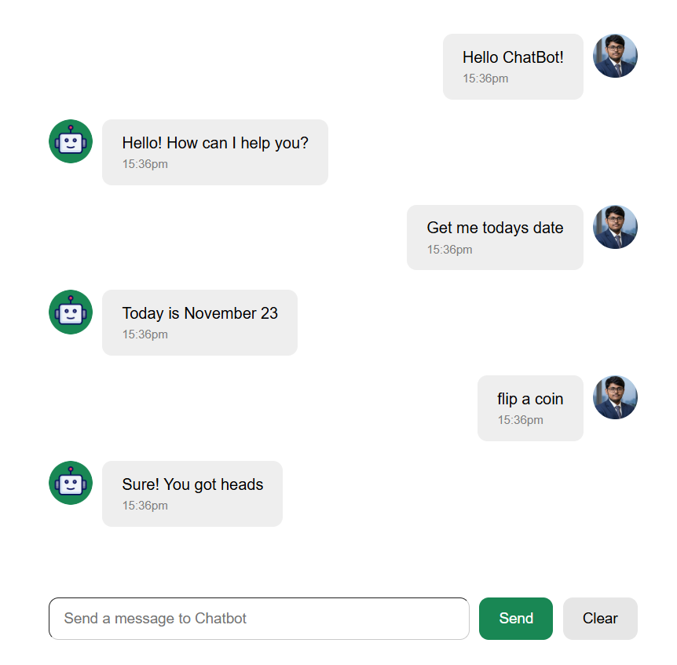
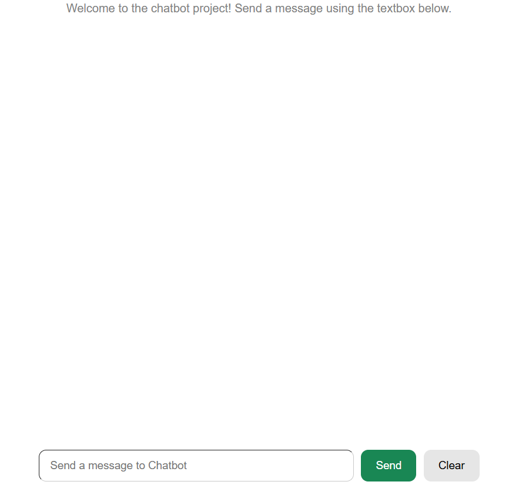

# 🤖 Chatbot Project

A simple and interactive chatbot application built using React and Vite. This project demonstrates React fundamentals, reusable components, state management, and handling asynchronous chatbot responses.

## 📸 Project Screenshots

### Chatbot Conversation



### Chatbot Home Screen



## ✨ Features

- Interactive chatbot interface
- User and robot message display
- Predefined responses to React-related questions
- Asynchronous chatbot responses using SuperSimpleDev
- Chat history saved in browser Local Storage
- Loading spinner while waiting for responses
- Clear chat functionality
- Send messages using the Enter key
- Clear the input using the Escape key

## 🛠️ Technologies Used

- React 19
- JavaScript
- Vite
- CSS
- Day.js
- SuperSimpleDev

## 📁 Project Structure

```text
chatbot-project/
├── public/
├── src/
│   ├── assets/
│   ├── components/
│   │   ├── ChatInput.jsx
│   │   ├── ChatInput.css
│   │   ├── ChatMessage.jsx
│   │   ├── ChatMessage.css
│   │   ├── ChatMessages.jsx
│   │   └── ChatMessages.css
│   ├── App.jsx
│   ├── App.css
│   └── main.jsx
├── .gitignore
├── index.html
├── package.json
├── package-lock.json
├── README.md
└── vite.config.js
```

## 🚀 Getting Started

Follow these steps to run the project locally.

### 1. Clone the repository

```bash
git clone YOUR_GITHUB_REPOSITORY_URL
```

### 2. Navigate to the project folder

```bash
cd chatbot-project
```

### 3. Install dependencies

```bash
npm install
```

### 4. Start the development server

```bash
npm run dev
```

Open the local URL displayed in your terminal to use the chatbot.

## 📦 Available Commands

| Command | Description |
|---|---|
| `npm run dev` | Start development server |
| `npm run build` | Create production build |
| `npm run lint` | Run ESLint checks |
| `npm run preview` | Preview production build |

## 💡 Learning Objectives

This project helped me practice:

- Understanding React components
- Managing state using `useState`
- Handling side effects using `useEffect`
- Passing data through props
- Handling user input and events
- Working with asynchronous JavaScript
- Saving data using Local Storage
- Organizing a React application into reusable components

## 👨‍💻 Author

Created as a learning project to practice React development and build interactive web applications.

---

⭐ If you find this project useful, feel free to explore the code and provide feedback!